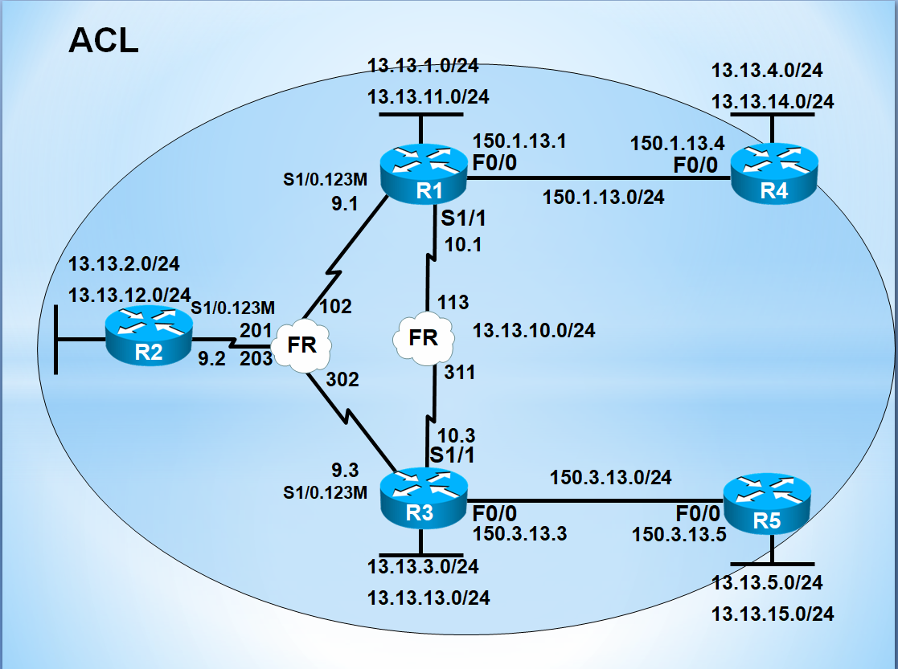

# Standard ACL (Numbered & Named)

> **Tag:** #Network #Cisco #ACL #Security #AccessControl **핵심 요약:** Cisco IOS ACL의 동작 원리와 Standard ACL(1\~99) 실무 활용 Numbered 방식과 Named 방식의 차이, 그리고 적용 위치(in/out) 결정 기준



***

## 1. 핵심 기술 개념 (Concept)

### Standard ACL을 목적지 인터페이스에 가깝게 적용해야 하는 이유

Standard ACL은 **출발지 IP만** 조건으로 볼 수 있기 때문에, 출발지 근처에 걸면 그 출발지에서 나가는 **모든 트래픽**이 차단된다. 목적지 근처에 걸어야 "특정 목적지로 향하는 트래픽만" 정밀하게 차단할 수 있다.

Extended ACL의 원칙(출발지 근처 in)과 정반대인 이유는 순전히 "필터링 정밀도" 때문이다. Standard는 조건 정보가 부족해서 넓게 차단하므로 늦게 걸어야 안전하다. 실무에서는 Standard ACL을 트래픽 필터링보다는 **VTY 접근 제어, NAT 매칭, 라우팅 재분배 필터링(distribute-list)** 용도로 더 많이 사용한다.

### Numbered ACL과 Named ACL의 선택 기준

운영망에서는 무조건 **Named ACL**을 써야 한다. Numbered ACL은 라인 단위 수정/삭제가 불가능해서 `no access-list 1` 한 줄로 전체가 날아가는 사고가 발생하고, 이름이 없어 목적 파악이 어렵다.

Named ACL은 시퀀스 번호(10, 20, 30...)로 특정 라인만 삽입/삭제할 수 있어 무중단 정책 변경이 가능하다. 이름을 `ACL_VTY_IN`, `ACL_NAT_INSIDE`처럼 목적 기반으로 짓는 것이 감사(audit) 관점에서도 유리하다.

***

## 2. 표준 설정 템플릿 (Configuration)

### ACL 동작 3대 원칙 (반드시 암기)

```cisco
! [원칙 1] 위에서 아래로 순차 매칭 → 구체적 조건이 먼저, 넓은 조건이 나중
! [원칙 2] 마지막에 암묵적 "deny any" 자동 추가 → 명시적 permit 없으면 다 차단
! [원칙 3] Numbered ACL은 라인 단위 수정 불가 → 부분 수정 시 전체 재작성 필요
```

### Numbered Standard ACL - 허용 정책 (일부만 열어주기)

```cisco
! 시나리오: 192.168.3.0/24 → 192.168.1.0/24 만 허용, 나머지 전부 차단
!
access-list 1 permit 192.168.3.0 0.0.0.255
! 명시적 permit 후 나머지는 암묵적 deny any 로 차단됨
!
interface FastEthernet0/0
 ip access-group 1 out
! Standard ACL은 목적지 인터페이스에 out 방향으로 적용 (원칙)
!
```

### Numbered Standard ACL - 차단 정책 (일부만 막기)

```cisco
! 시나리오: 192.168.1.0/24 만 차단, 나머지 전부 허용
!
access-list 2 deny 192.168.1.0 0.0.0.255
access-list 2 permit any
! 반드시 permit any 를 명시! (없으면 암묵적 deny any 로 전부 차단됨)
!
interface FastEthernet0/0
 ip access-group 2 out
!
```

### 연속된 서브넷 집약 (Wildcard Mask 활용)

```cisco
! 시나리오: 172.16.0.0/24 ~ 172.16.7.0/24 (8개 대역) 차단
!
! [비효율 방식] 8줄로 나열
access-list 3 deny 172.16.0.0 0.0.0.255
access-list 3 deny 172.16.1.0 0.0.0.255
! ... (생략) ...
access-list 3 deny 172.16.7.0 0.0.0.255
access-list 3 permit any
!
! [효율 방식] Wildcard로 8개 대역을 한 줄로 요약
access-list 3 deny 172.16.0.0 0.0.7.255
! 0.0.7.255 = 하위 3비트(=8개 서브넷) 무시하고 매칭
access-list 3 permit any
!
interface FastEthernet0/0
 ip access-group 3 out
!
```

### Named Standard ACL (실무 권장)

```cisco
! [Named ACL] 이름 기반 관리 + 시퀀스 번호로 라인 단위 편집 가능
!
ip access-list standard ACL_ALLOW_MGMT
 permit 10.10.10.0 0.0.0.255
 permit 10.10.20.0 0.0.0.255
 deny   any log        ! log 옵션: 차단 발생 시 syslog 출력 (트러블슈팅용)
!
interface FastEthernet0/0
 ip access-group ACL_ALLOW_MGMT out
!
! ▶ 특정 라인만 추가 (시퀀스 25번 자리에 삽입)
ip access-list standard ACL_ALLOW_MGMT
 25 permit 10.10.30.0 0.0.0.255
!
! ▶ 특정 라인만 삭제
ip access-list standard ACL_ALLOW_MGMT
 no 25
!
```

### VTY 접근 제어 (Standard ACL의 대표 실무 용도)

```cisco
! Telnet/SSH 접근을 특정 관리 대역에서만 허용 → Standard ACL의 실전 활용
!
ip access-list standard ACL_VTY_ADMIN
 permit 10.10.10.0 0.0.0.255
 deny   any log
!
line vty 0 4
 access-class ACL_VTY_ADMIN in
! interface가 아닌 line에 적용 시 "access-class" 명령 사용 (주의!)
 transport input ssh
!
```

## 3. 검증 및 트러블슈팅 (Verification & Troubleshooting)

### 필수 검증 명령어

```cisco
! ACL 룰과 매칭 카운터(hit count) 확인 → 실제 어떤 라인이 동작하는지
show access-lists
show access-lists 1
show ip access-lists ACL_ALLOW_MGMT

! 인터페이스별 ACL 바인딩 확인 (in/out 방향)
show ip interface FastEthernet0/0 | include access list
!  Outgoing access list is 1
!  Inbound  access list is not set

! VTY에 걸린 ACL 확인
show running-config | section line vty
```

### 트러블슈팅 시나리오 1: ACL 적용 후 모든 통신이 끊겼다

* **증상:** `deny` 한 줄만 넣었는데 정상 트래픽까지 전부 차단됨.
* **원인 파악:**
  1. `show access-lists` 로 확인 → `deny` 라인만 있고 `permit any` 가 없음.
  2. 마지막 암묵적 `deny any` 가 나머지 트래픽을 전부 차단한 것.
*   **해결법:**

    ```cisco
    ! 반드시 마지막에 permit any 추가
    ip access-list standard ACL_NAME
     deny  192.168.1.0 0.0.0.255
     permit any                    ! ★ 이 줄이 누락되면 전체 차단
    ```

### 트러블슈팅 시나리오 2: ACL 수정하려다 전체가 날아갔다

* **증상:** Numbered ACL에서 특정 라인을 삭제하려고 `no access-list 1 permit ...` 입력 → ACL 전체가 사라짐 → 인터페이스가 존재하지 않는 ACL 참조 상태.
* **원인 파악:**
  * Numbered ACL은 **라인 단위 삭제 불가**. `no access-list <번호>` 는 전체 삭제 명령으로 동작.
* **해결법:**
  1. **긴급 조치:** 인터페이스에서 먼저 `no ip access-group 1 in` 으로 ACL 해제 → 트래픽 통과 상태 확보.
  2. **재작성:** ACL 전체를 다시 입력.
  3. **재적용:** 인터페이스에 다시 `ip access-group 1 in` 바인딩.
* **재발 방지:**
  * 운영망은 반드시 **Named ACL** 사용 → 시퀀스 번호로 라인 단위 수정 가능.
  * 변경 전 반드시 `show running-config | section access-list` 로 백업 확보.

### 트러블슈팅 시나리오 3: VTY 접근이 갑자기 안 된다

* **증상:** SSH 접속 시도 시 즉시 연결 종료(connection refused).
* **원인 파악:**
  1. `show running-config | section line vty` → `access-class` 설정 확인.
  2. `show access-lists ACL_VTY_ADMIN` → 관리자 PC IP가 permit 대역에 포함되어 있는지 확인.
* **해결법:**
  * 콘솔 접속으로 진입 후 관리자 IP 대역을 permit 라인에 추가.
  * `access-class` 는 `interface`가 아닌 `line`에 적용된다는 점을 반드시 기억.

### Standard ACL 실무 체크리스트

* [ ] Standard ACL을 **목적지 인터페이스 out** 방향에 적용했는가?
* [ ] 명시적 `deny` 뒤에 `permit any` 를 넣어 나머지를 열어줬는가? (또는 반대)
* [ ] Numbered 대신 **Named ACL** 을 사용해 유지보수성을 확보했는가?
* [ ] Wildcard Mask로 연속 대역을 집약해서 라인 수를 줄였는가?
* [ ] VTY 접근 제어는 `access-group`이 아닌 **`access-class`** 를 사용했는가?

***

]
