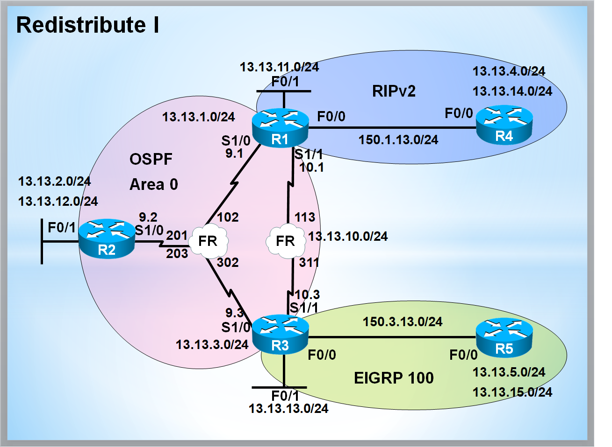

# Route Redistribution with Route-Map Filtering

> **Tags:** #Routing #OSPF #EIGRP #RIPv2 #Redistribution #RouteMap #PrefixList **핵심 요약:** **Topology:** R1(OSPF/RIP) ↔ R2(OSPF Hub) ↔ R3(OSPF/EIGRP) / R4(RIP) / R5(EIGRP)



***

## 1. 핵심 기술 개념 (Concept)

### Q1. 실무에서 재분배(Redistribution)를 설계할 때 가장 경계해야 할 것은 무엇이며, 왜 반드시 Route-Map + Prefix-List 조합을 써야 하나요?

* 👉 **핵심 답변:** **라우팅 루프(Routing Loop)와 차선 경로(Sub-optimal Path) 문제**입니다. 서로 다른 AD값과 Metric 체계를 가진 프로토콜이 양방향으로 재분배될 때, Tag 기반 필터링 없이 설정하면 자기가 보낸 경로가 다시 자기에게 돌아오는 피드백 루프가 반드시 발생합니다.
* **꼬리 질문 대비 설명:**
  * **AD 역전 현상:** OSPF(110)에서 배운 경로가 EIGRP로 재분배되면 D EX(170)가 되지만, 반대 경로에서 EIGRP Internal(90)로 다시 들어오면 원래 OSPF 경로보다 우선되어 트래픽이 엉뚱한 방향으로 흐릅니다. → **Route-Map에 `set tag`를 찍고, 반대편에서 `match tag`로 deny** 하는 것이 실무 표준 패턴입니다.
  * **Connected 자동 포함의 함정:** `redistribute rip`을 하면 RIP에 `network` 등재된 **인터페이스의 Connected 네트워크까지 자동으로 OSPF로 흘러갑니다.** 이 때문에 사설망(RFC1918)이 의도치 않게 외부로 광고되는 사고가 잦으므로, **Prefix-list로 사설망 명시적 deny**가 필수입니다.

### Q2. OSPF 재분배 시 E1과 E2의 선택 기준은 무엇인가요? 왜 Cisco 기본값이 E2인지 실무 관점에서 설명해 주세요.

* 👉 **핵심 답변:** **ASBR까지의 경로가 다중이면 E1(누적 Metric), 단일 경로이면 E2(고정 Metric=20)** 를 씁니다. Cisco 기본값이 E2인 이유는 대부분의 Stub-like 엣지 재분배 시나리오에서 계산 오버헤드를 줄이고, 동일한 외부 경로에 대해 라우터마다 다른 판단을 하지 않도록 일관성을 확보하기 위함입니다.
* **꼬리 질문 대비 설명:**
  * **E2의 함정:** ASBR이 2개 이상인데 E2를 그대로 두면, Metric이 20으로 동일해 **가까운 ASBR을 선택하지 못하고 Router-ID나 첫 학습 순서로 결정**되어 트래픽 엔지니어링이 어려워집니다.
  * **선택 기준 요약:** Dual-ASBR 환경 → **E1 + 초기 Metric 설정**, Single-ASBR/Stub 환경 → **E2 유지**.

***

## 2. 표준 설정 템플릿 (Configuration)

### 2-1. Connected OSPF 재분배 (Route-Map 필터링)

```cisco
! === R2: FastEthernet 0/1의 13.13.12.0/24만 OSPF로 재분배 ===
! 불필요한 Loopback(100.10.1.0, 200.20.2.0)은 광고 차단

ip prefix-list ALLOW_CONN permit 13.13.12.0/24        ! 재분배 허용 대역만 명시
!
route-map CONN->OSPF permit 10
 match ip address prefix-list ALLOW_CONN              ! Prefix-list에 매치되는 것만 permit
!
router ospf 1
 redistribute connected subnets route-map CONN->OSPF  ! subnets 키워드 필수 (classful 방지)
!
```

### 2-2. RIPv2 OSPF 재분배 (다중 조건 필터링)

```cisco
! === R1: 사설망 차단 + 특정망 E1/Metric100 + 특정망 Tag199 ===

! [1] 사설망 차단용 Prefix-list (RFC1918)
ip prefix-list PRIVATE permit 10.0.0.0/8 le 32
ip prefix-list PRIVATE permit 172.16.0.0/12 le 32
ip prefix-list PRIVATE permit 192.168.0.0/16 le 32
!
! [2] E1 Metric-type 변경 대상
ip prefix-list METRIC_E1 permit 150.1.13.0/24
ip prefix-list METRIC_E1 permit 13.13.4.0/24
ip prefix-list METRIC_E1 permit 13.13.14.0/24
!
! [3] Tag 부착 대상 (199.171.0.0 ~ 199.171.7.0 을 /21로 묶음)
ip prefix-list TAG199 permit 199.171.0.0/21 le 32
!
! === Route-Map: 순서(sequence)가 곧 우선순위 ===
route-map RIP->OSPF deny 10
 match ip address prefix-list PRIVATE                 ! 사설망은 최우선 차단
!
route-map RIP->OSPF permit 20
 match ip address prefix-list METRIC_E1
 set metric-type type-1                               ! E1으로 변경 (누적 Metric)
 set metric 100                                       ! 초기 Metric 100
!
route-map RIP->OSPF permit 30
 match ip address prefix-list TAG199
 set tag 199                                          ! 루프 방지용 Tag
!
route-map RIP->OSPF permit 40                         ! 나머지는 기본값(E2/Metric20)으로 통과
!
router ospf 1
 redistribute rip subnets route-map RIP->OSPF
!
```

### 2-3. OSPF RIPv2 재분배 (Offset-list로 Metric 보정)

```cisco
! === R1: OSPF 경로를 RIP Metric 4로 광고 ===
! 문제점: R1의 Connected(13.13.1.0/9.0/10.0)는 RIP network 명령에 포함되어
!         재분배 대상이 아닌 순수 RIP 경로(Metric 1)로 광고됨 → Metric 불일치 발생

access-list 1 permit 13.13.1.0  0.0.0.255
access-list 1 permit 13.13.9.0  0.0.0.255
access-list 1 permit 13.13.10.0 0.0.0.255
!
router rip
 redistribute ospf 1 metric 4                         ! OSPF → RIP: Metric 4로 고정
 offset-list 1 out 3 FastEthernet0/0                  ! ACL 1 매칭 경로에 +3 → 총 Metric 4로 통일
!
```

### 2-4. EIGRP OSPF 재분배 (Metric-type 혼합 + Tag)

```cisco
! === R3: 4.1.1.0 + 198.198.x.x 는 E2/Metric200, 나머지는 E1 + Tag300 ===

ip prefix-list EIGRP_E2 permit 4.1.1.0/24
ip prefix-list EIGRP_E2 permit 198.198.0.0/16 le 32
!
route-map EIGRP->OSPF permit 10
 match ip address prefix-list EIGRP_E2
 set metric-type type-2                               ! 고정 Metric
 set metric 200
!
route-map EIGRP->OSPF permit 20
 set metric-type type-1                               ! 누적 Metric
 set tag 300                                          ! 반대편 재분배 시 loop 차단용
!
router ospf 1
 redistribute eigrp 100 subnets route-map EIGRP->OSPF
!
```

### 2-5. OSPF EIGRP 재분배 (선택적 광고)

```cisco
! === R3: 199.171.0~7만 Tag100 부착, 199.171.8~은 완전 차단, 나머지 전부 재분배 ===

ip prefix-list TAG100 permit 199.171.0.0/21 le 32     ! 0~7 대역 (/21 = 8개 /24)
ip prefix-list DENY199 permit 199.171.0.0/16 le 32    ! 199.171 전체 catch-all
!
route-map OSPF->EIGRP permit 10
 match ip address prefix-list TAG100
 set tag 100                                          ! 허용 대역: Tag 부착
!
route-map OSPF->EIGRP deny 20
 match ip address prefix-list DENY199                 ! 나머지 199.171.x 대역: 명시적 차단
!
route-map OSPF->EIGRP permit 30                       ! 그 외 모든 경로: 통과
!
router eigrp 100
 redistribute ospf 1 metric 100000 10 255 1 1500 route-map OSPF->EIGRP
!                                        ! BW  Delay Rel Load MTU (5개 필수)
```

***

## 3. 검증 및 트러블슈팅 (Verification & Troubleshooting)

### 3-1. 필수 검증 명령어

```cisco
! [경로 확인]
show ip route ospf | include E1              ! Metric-type 1 경로만
show ip route ospf | include E2              ! Metric-type 2 경로만
show ip route eigrp | include EX             ! EIGRP External 경로
show ip route rip

! [LSA / Topology 상세 - Tag 값 확인 필수]
show ip ospf database                        ! Type-5 External LSA에서 Tag 컬럼 확인
show ip eigrp topology | include tag         ! EIGRP는 topology table에서 tag 확인

! [Route-Map 매칭 통계 - 필터 동작 여부 검증]
show route-map RIP->OSPF                     ! Match count / Set clauses 확인
show ip prefix-list                          ! Prefix-list hit count

! [강제 갱신]
clear ip route *                             ! 라우팅 테이블 초기화 (실무에선 신중히!)
clear ip ospf process                        ! OSPF 프로세스 재시작
```

### 3-2. 대표 장애 시나리오 & 트러블슈팅

#### 시나리오 1: "재분배했는데 특정 경로가 광고되지 않아요"

| 단계    | 확인 사항                                                         | 명령어/조치                                                        |
| ----- | ------------------------------------------------------------- | ------------------------------------------------------------- |
| **①** | `subnets` 키워드 누락 여부 (OSPF의 대표적 실수)                            | `show run \| sec router ospf` → `redistribute ... subnets` 확인 |
| **②** | Route-Map의 **마지막 sequence permit 누락** (Implicit deny로 전부 차단됨) | `route-map XXX permit 999` (catch-all) 추가                     |
| **③** | Prefix-list의 `le/ge` 옵션 오류                                    | `/24 le 32`가 아니면 정확히 그 prefix만 매치됨                            |
| **④** | 재분배 대상 프로토콜의 라우팅 테이블에 실제 경로 존재 여부                             | `show ip route [protocol]`                                    |

#### 시나리오 2: "양방향 재분배 후 Sub-optimal Path 또는 Loop 발생"

* **증상:** OSPF 내부 경로가 EIGRP를 거쳐 다시 OSPF로 돌아와 D EX(170)가 O(110)를 이겨야 하는데 반대로 되거나, Traceroute가 이상한 경로를 탐.
* **원인:** 상호 재분배 지점(Mutual Redistribution Point) 2군데 이상에서 Tag 필터링 미적용.
* **해결 절차:**
  1. **Outbound에서 Tag 부착:** `route-map A->B permit 10` / `set tag 100`
  2.  **반대편 Inbound에서 Tag 차단:**

      ```cisco
      route-map B->A deny 5
      match tag 100
      route-map B->A permit 10
      ! ... 나머지 정상 재분배 로직
      ```
  3. **AD 조정 (최후의 수단):** `distance` 명령으로 특정 경로의 AD를 강제 조정. 단, 운영 중 변경은 트래픽 순단을 유발하므로 유지보수 시간에만.

***

]
