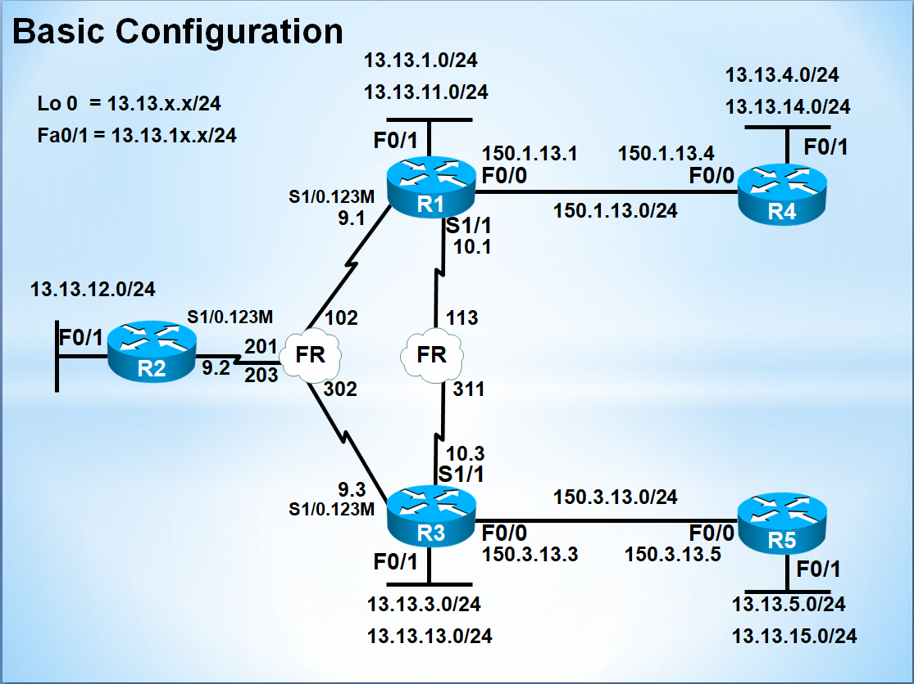

# 라우팅 기초 통합 정리

> **Tag:** #Network #Routing #Static #Dynamic #RIB #FIB #CEF #AD #Metric #Concept #Summary **핵심 요약:** 라우팅은 도달 가능한 경로를 **수집(Discovery) → 비교·선택(Selection) → 변화에 맞게 유지(Management)** 하는 과정이다. Static은 관리자가 직접 경로를 입력하고 Dynamic은 라우팅 프로토콜이 자동 학습한다. 동일 Prefix의 경로 출처가 다르면 AD, 같은 프로토콜 안에서는 Metric으로 RIB 경로를 선택하며, 실제 패킷 전달은 FIB에서 Longest Prefix Match로 처리한다. 소규모·Stub 구간은 Static, 변화가 많은 망은 Dynamic, 실무에서는 두 방식을 함께 사용하는 하이브리드 구성이 일반적이다.



***

## 1. 핵심 기술 개념 (Concept)

### Q1. 라우팅을 관통하는 기본 흐름은?

👉 **핵심 답변:** **경로를 모으고(Discovery) → 최적 경로를 고르고(Selection) → 변화가 발생하면 경로를 갱신(Management)** 하는 흐름입니다.

```properties
[1단계 Path Discovery]
Connected·Static·Dynamic Protocol로 도달 가능한 경로 수집

        ↓

[2단계 Path Selection]
동일 Prefix 후보 비교
경로 출처가 다르면 AD, 같은 프로토콜이면 Metric 비교

        ↓

[3단계 Path Management]
링크·Neighbor·Topology 변화 감지 및 경로 갱신

        ↓

[RIB → FIB]
선택 경로를 실제 포워딩 테이블로 반영
```

* RIB는 컨트롤 플레인의 경로 선택 결과
* FIB는 데이터 플레인이 실제 패킷 전달에 사용하는 테이블
* Dynamic Routing은 Neighbor, Topology, Database 정보를 바탕으로 경로를 유지
* Static Routing은 관리자가 변경하지 않는 한 정책이 자동으로 바뀌지 않음

> Discovery·Selection·Management는 라우팅 동작을 설명하기 위한 개념적 구분입니다. 실제 구현과 테이블 구조는 프로토콜마다 다릅니다.

***

### Q2. AD, Metric, Longest Prefix Match는 어떤 순서로 사용되는가?

👉 **핵심 답변:** 먼저 동일 Prefix를 제공하는 경로 후보 중 AD와 Metric을 이용해 RIB에 설치할 경로를 정하고, 패킷을 전달할 때는 목적지와 가장 구체적으로 일치하는 Prefix를 선택합니다.

#### RIB 설치 단계

```properties
같은 Prefix를 서로 다른 출처에서 학습
        ↓
Administrative Distance 비교
        ↓
낮은 AD의 경로를 우선
```

```properties
같은 Prefix를 동일 프로토콜에서 여러 경로로 학습
        ↓
프로토콜 Metric 비교
        ↓
더 좋은 Metric의 경로를 우선
```

#### 패킷 포워딩 단계

```properties
목적지 IP와 일치하는 RIB/FIB 경로 검색
        ↓
Longest Prefix Match
        ↓
가장 긴 Prefix Length 선택
```

예시:

```
0.0.0.0/0
10.0.0.0/8
10.20.0.0/16
10.20.30.0/24
```

목적지 `10.20.30.5`는 `/24` 경로를 사용합니다. `/24`의 AD가 Default Route보다 높아도 더 구체적인 `/24`가 먼저 선택됩니다.

***

### Q3. Static과 Dynamic을 나누는 실무 기준은?

👉 **핵심 답변:** **네트워크 규모, 경로 수, 변경 빈도, 장애 대응 요구사항**을 기준으로 결정합니다.

| 구분      | Static Routing       | Dynamic Routing    |
| ------- | -------------------- | ------------------ |
| 경로 등록   | 관리자 수동               | 프로토콜 자동 학습         |
| CPU/메모리 | 낮음                   | 프로토콜 오버헤드 존재       |
| 제어 트래픽  | 없음                   | Hello·Update·LSA 등 |
| 장애 대응   | 기본적으로 수동             | 자동 재수렴             |
| 예측 가능성  | 높음                   | 설계와 토폴로지에 따라 변화    |
| 확장성     | 낮음                   | 높음                 |
| 적합 환경   | Stub·DMZ·Default·소규모 | 캠퍼스·DC·WAN·백본      |

> Static Route도 재귀 해석, CEF 반영, IP SLA 감시 등에 장비 자원을 사용하므로 CPU 부담이 완전히 0인 것은 아닙니다.

***

### Q4. Static Route가 적합한 대표 환경은?

* 경로가 하나뿐인 Stub Network
* 인터넷 또는 상위 Router 방향의 Default Route
* Dynamic Routing을 실행하지 않는 보안 경계
* 관리망·Loopback 등 고정 경로
* Dynamic Routing의 백업인 Floating Static
* 특정 관리 Prefix에 대한 명시적 경로

```cisco
ip route 0.0.0.0 0.0.0.0 203.0.113.1
```

> Static Route는 목적지 Prefix 기반으로 동작합니다. Source IP, Port, Application 등의 조건으로 경로를 바꾸는 PBR의 대체 수단은 아닙니다.

***

### Q5. 운영 중 사고가 많이 발생하는 단계는?

👉 **핵심 답변:** 토폴로지 변화와 장애에 대응하는 **Path Management** 단계에서 수렴 지연, Flapping, Loop, Blackhole 등이 발생하기 쉽습니다.

다만 Static Routing에서는 다음 문제가 더 흔합니다.

* Return Path 누락
* 잘못된 Next-hop
* Ethernet에 Exit Interface만 지정
* Floating Static의 Silent Failure
* 더 구체적인 경로가 Default Route를 덮음
* RIB에는 있지만 ARP/Adjacency가 해결되지 않음

Dynamic Routing에서는 다음을 추가로 확인합니다.

* Neighbor 상태
* Topology/LSDB
* Protocol Timer
* Metric과 Policy
* Redistribution과 Route Tag

***

## 2. 표준 개념 및 설정

### 2-1. 라우팅 3대 기능

```properties
[Discovery]
Connected·Static·Dynamic Protocol에서 경로 수집

[Selection]
동일 Prefix 후보의 AD·Metric 비교

[Management]
경로 변화 감지, 갱신, 제거 및 재수렴

[RIB]
선택된 경로를 보관하는 컨트롤 플레인 테이블

[FIB/Adjacency]
실제 패킷 전달에 사용하는 데이터 플레인 정보
```

***

### 2-2. Static Route 기본 문법

```cisco
! Default Route
ip route 0.0.0.0 0.0.0.0 203.0.113.1
!
! Next-hop 방식
ip route 10.20.30.0 255.255.255.0 10.1.1.2
!
! Exit Interface 방식 — P2P 링크에서 적합
ip route 10.20.30.0 255.255.255.0 Serial0/0
!
! Fully Specified Static — Ethernet/Multi-Access에서 명확한 해석
ip route 10.20.30.0 255.255.255.0 GigabitEthernet0/0 10.1.1.2
!
! Floating Static
ip route 10.20.30.0 255.255.255.0 10.2.2.2 200
```

***

### 2-3. Next-hop vs Exit Interface

| 방식                 | 권장 환경                 | 동작                           |
| ------------------ | --------------------- | ---------------------------- |
| Next-hop IP        | Ethernet·Multi-Access | Next-hop까지 재귀 조회             |
| Exit Interface     | HDLC·PPP 등 P2P        | 지정 Interface로 직접 전송          |
| Exit IF + Next-hop | Multi-Access          | Interface와 L3 Next-hop 모두 명시 |

#### Ethernet 주의

```cisco
ip route 10.20.30.0 255.255.255.0 GigabitEthernet0/0
```

Broadcast Multi-Access Ethernet에서 위와 같이 Exit Interface만 지정하면 Router가 목적지 IP를 직접 연결된 것처럼 처리하여 목적지별 ARP를 시도할 수 있습니다. Proxy ARP 의존, ARP 증가 및 통신 실패 원인이 될 수 있습니다.

권장:

```cisco
ip route 10.20.30.0 255.255.255.0 10.1.1.2
```

또는:

```cisco
ip route 10.20.30.0 255.255.255.0 GigabitEthernet0/0 10.1.1.2
```

***

### 2-4. Administrative Distance

| 경로 출처          | 기본 AD |
| -------------- | ----: |
| Connected      |     0 |
| Static         |     1 |
| eBGP           |    20 |
| EIGRP Internal |    90 |
| OSPF           |   110 |
| RIP            |   120 |
| EIGRP External |   170 |
| iBGP           |   200 |

> 기본값은 Cisco IOS 기준이며 플랫폼·프로토콜 설정으로 변경할 수 있습니다.

```properties
낮은 AD = 동일 Prefix를 제공하는 서로 다른 경로 출처 중 더 신뢰
```

Floating Static 예시:

```cisco
ip route 10.20.30.0 255.255.255.0 10.1.1.2
ip route 10.20.30.0 255.255.255.0 10.2.2.2 200
```

* Primary Static AD = 1
* Backup Static AD = 200
* Primary 경로가 RIB에서 제거되어야 Backup이 활성화

***

### 2-5. Stub Router Default Route

```cisco
interface FastEthernet0/0
 ip address 192.168.1.254 255.255.255.0
 no shutdown
!
interface Serial1/0
 encapsulation hdlc
 bandwidth 64
 ip address 192.168.12.1 255.255.255.0
 no shutdown
!
ip route 0.0.0.0 0.0.0.0 192.168.12.2
```

> `bandwidth 64`는 Interface의 논리적 Bandwidth Reference를 변경합니다. 실제 Serial Clock이나 물리적 전송 속도를 직접 제한하는 명령은 아닙니다.

***

### 2-6. Transit Router 양방향 Static

```cisco
interface FastEthernet0/0
 ip address 192.168.2.254 255.255.255.0
 no shutdown
!
interface Serial1/1
 encapsulation hdlc
 bandwidth 64
 clock rate 64000
 ip address 192.168.12.2 255.255.255.0
 no shutdown
!
interface Serial1/0
 encapsulation hdlc
 bandwidth 64
 clock rate 64000
 ip address 192.168.23.2 255.255.255.0
 no shutdown
!
ip route 192.168.1.0 255.255.255.0 192.168.12.1
ip route 192.168.3.0 255.255.255.0 192.168.23.3
```

> `clock rate`는 DCE Interface에만 설정합니다. 실제 DCE/DTE 역할은 `show controllers serial`로 확인해야 합니다.

***

### 2-7. 반대편 Stub Router

```cisco
interface FastEthernet0/0
 ip address 192.168.3.254 255.255.255.0
 no shutdown
!
interface Serial1/1
 encapsulation hdlc
 bandwidth 64
 ip address 192.168.23.3 255.255.255.0
 no shutdown
!
ip route 0.0.0.0 0.0.0.0 192.168.23.2
```

***

### 2-8. IP SLA + Track 기반 Floating Static

단순 Floating Static은 Primary Route가 RIB에 남아 있으면 Backup으로 전환되지 않습니다. 상위망 Silent Failure까지 감지하려면 IP SLA와 Track을 사용합니다.

```cisco
! Primary ISP를 통해서만 Probe가 나가도록 Host Route 고정
ip route 198.51.100.10 255.255.255.255 203.0.113.1
!
ip sla 1
 icmp-echo 198.51.100.10 source-interface GigabitEthernet0/0
 frequency 5
!
ip sla schedule 1 life forever start-time now
!
track 1 ip sla 1 reachability
!
! Primary Default — Track 연동
ip route 0.0.0.0 0.0.0.0 203.0.113.1 track 1
!
! Backup Default
ip route 0.0.0.0 0.0.0.0 192.0.2.1 200
```

> Probe 대상은 운영 환경에서 안정적으로 응답하고 Primary 회선 상태를 대표할 수 있는 주소를 사용합니다. 문서용 IP는 실제 설정에 사용하지 않습니다.

***

## 3. 검증 및 트러블슈팅

### 3-1. Control Plane 검증

```cisco
show ip route
show ip route static
show ip route 10.20.30.5
show ip route summary
show ip protocols
show running-config | include ^ip route
```

### 3-2. Data Plane 검증

```cisco
show ip cef 10.20.30.5
show ip cef 10.20.30.5 detail
show adjacency
show adjacency detail
show arp
```

```properties
RIB = 어떤 경로를 사용할지 결정
FIB = 목적지 Prefix와 Next-hop/Interface를 고속 조회
Adjacency = 실제 전송에 필요한 L2 Rewrite 정보
```

### 3-3. 연결성 검증

```cisco
show ip interface brief
show interfaces
show controllers serial 1/0
show cdp neighbors
ping 10.20.30.5
ping 10.20.30.5 source FastEthernet0/0
traceroute 10.20.30.5
```

### 3-4. IP SLA/Track 검증

```cisco
show ip sla configuration
show ip sla statistics
show track 1
show ip route 0.0.0.0
```

***

## 4. 대표 함정

| 함정                     | 실제 결과                                | 권장 조치                       |
| ---------------------- | ------------------------------------ | --------------------------- |
| Return Path 누락         | 요청은 가지만 응답 실패                        | 반대편 경로 확인                   |
| Ethernet Exit IF만 지정   | 목적지별 ARP·Proxy ARP 의존                | Next-hop 또는 Fully Specified |
| Next-hop 장비만 다운        | Connected Route가 남으면 Static도 남을 수 있음 | IP SLA + Track              |
| Floating 전환 안 됨        | Primary가 RIB에 계속 존재                  | Track으로 경로 제거               |
| AD만 보고 판단              | 더 구체적인 Prefix가 우선                    | Longest Prefix Match 확인     |
| `bandwidth`로 속도 제한 기대  | 실제 물리 속도는 변하지 않음                     | Clock/QoS 별도 확인             |
| Static으로 Source별 경로 제어 | 목적지 기반으로만 선택                         | PBR 검토                      |
| RIB만 확인                | ARP/CEF 문제를 놓침                       | FIB·Adjacency 함께 확인         |

***

> 📌 **핵심 요약**
>
> * 라우팅 흐름: **Discovery → Selection → Management**
> * 동일 Prefix 후보: **AD → Metric**
> * 실제 포워딩: **Longest Prefix Match**
> * Ethernet: Next-hop 또는 Fully Specified Static 권장
> * Floating Static은 Primary 경로가 RIB에서 제거돼야 활성화
> * Silent Failure: **IP SLA + Track**
> * RIB는 결과, 실제 전달은 **CEF FIB + Adjacency**
> * 관련: 1. 📖 라우팅(Routing) 기초 개념 · 2. 📍 Static Route (정적 라우팅) · 3. ⚡ 라우터의 스위칭 방식 (CEF) · 5. 🚑 라우팅 기초 트러블슈팅 치트시트 · 6. ⚡ 라우팅 기초 명령어 퀵 레퍼런스
