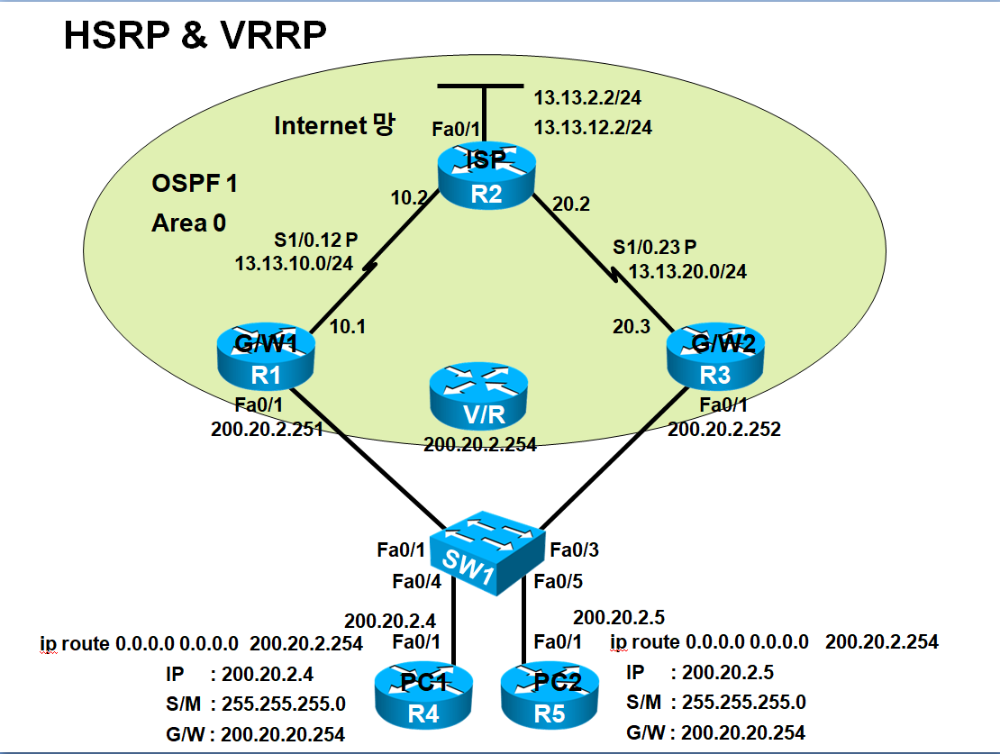

# HSRP & VRRP (Gateway Redundancy)

> **Tag:** #network #fhrp #hsrp #vrrp #gateway-redundancy #track #cisco **핵심 요약:** 게이트웨이 단일 장애점(SPOF)을 제거하는 First-Hop Redundancy Protocol. Virtual IP/MAC과 Track이 핵심



***

## 1. 핵심 기술 개념 (Concept)

### Q. 게이트웨이 이중화가 필요한 이유와, Virtual IP/MAC이 왜 핵심인가요?

* 👉 **핵심 답변:** 내부 단말은 게이트웨이 IP 하나만 바라보므로, 그 게이트웨이가 죽으면 외부 통신이 전면 마비됩니다(SPOF). FHRP는 **가상의 게이트웨이(Virtual IP + Virtual MAC)** 를 만들어 단말은 이 가상 주소만 바라보게 하고, 실제 처리는 Active/Master 라우터가 담당하다가 장애 시 Standby/Backup이 **동일한 가상 IP/MAC을 그대로 이어받아** 단말 설정 변경 없이 무중단 전환합니다.
* **꼬리 질문 대비 설명:**
  * 단말의 ARP 테이블에는 가상 MAC이 들어있어, 장애가 나도 게이트웨이 MAC이 바뀌지 않으므로 재ARP 없이 통신이 유지됩니다.
  * HSRP 가상 MAC: `0000.0C07.AC.[group]`, VRRP 가상 MAC: `0000.5E00.01.[group]`.

### Q. HSRP와 VRRP의 차이는? (실무 선택 기준)

* 👉 **핵심 답변:** **HSRP는 Cisco 전용**, **VRRP는 업계 표준**입니다. 멀티벤더 환경이면 VRRP, 순수 Cisco 환경이면 HSRP를 씁니다. 동작 원리는 거의 동일하되 용어와 기본값이 다릅니다.
* **꼬리 질문 대비 설명:**
  * 역할 용어: HSRP는 **Active/Standby**, VRRP는 **Master/Backup**.
  * **Preempt 기본값**: HSRP는 **기본 비활성**(우선순위 높아도 자동으로 Active 탈환 안 함), VRRP는 **기본 활성**. 이 차이가 실무 사고의 흔한 원인.

### Q. FHRP의 가장 중요한 한계와 그 해결책은?

* 👉 **핵심 답변:** FHRP는 **LAN(내부 인터페이스) 장애만 감지**하고, 게이트웨이의 **WAN(업링크) 장애는 감지하지 못합니다.** 즉 내부 포트는 살아있고 외부 회선만 끊기면, Active는 그대로 Active를 유지해 트래픽이 블랙홀에 빠집니다. 이를 해결하는 것이 **Track(인터페이스/객체 추적)** 기능입니다.
* **꼬리 질문 대비 설명:**
  * Track은 지정한 WAN 인터페이스가 다운되면 **우선순위를 자동 차감(decrement)** 해, Standby가 더 높은 우선순위를 갖게 되어 Active를 넘겨받습니다.
  * Track이 동작하려면 Standby 쪽에 **preempt가 설정되어 있어야** 우선순위 역전 시 실제로 역할을 탈취할 수 있습니다.

### HSRP vs VRRP 비교

| 항목          | HSRP                 | VRRP            |
| ----------- | -------------------- | --------------- |
| 표준          | Cisco 전용             | 업계 표준           |
| 역할          | Active / Standby     | Master / Backup |
| 가상 MAC      | 0000.0C07.AC.xx      | 0000.5E00.01.xx |
| Preempt 기본값 | 비활성                  | 활성              |
| Hello/Dead  | 3초 / 10초             | 1초 / 3초         |
| 멀티캐스트       | 224.0.0.2 (UDP 1985) | 224.0.0.18      |

***

## 2. 표준 설정 템플릿 (Configuration)

### HSRP 기본 구성 (Active/Standby)

```cisco
! === G/W1 (Active로 동작) ===
G/W1(config)# interface fastethernet 0/1
G/W1(config-if)# standby 1 ip 200.20.2.254        ! Virtual IP (단말의 게이트웨이 IP)
G/W1(config-if)# standby 1 priority 150            ! 높을수록 Active (기본 100)
G/W1(config-if)# standby 1 timers 1 3              ! Hello 1초 / Dead 3초 (빠른 감지)
G/W1(config-if)# standby 1 preempt                 ! 복구 시 Active 탈환 (HSRP는 기본 꺼짐)

! === G/W2 (Standby로 동작) ===
G/W2(config)# interface fastethernet 0/1
G/W2(config-if)# standby 1 ip 200.20.2.254         ! 동일한 Virtual IP
G/W2(config-if)# standby 1 priority 100
G/W2(config-if)# standby 1 timers 1 3
```

### Preempt Delay (복구 후 즉시 탈환 방지)

```cisco
! 장애 복구 직후 라우팅 수렴 전에 Active를 뺏으면 순간 단절 발생 → 지연을 둠
G/W1(config-if)# standby 1 preempt delay minimum 60   ! 복구 60초 후 Active 탈환
```

### Track으로 WAN 장애 대응 (FHRP 한계 극복 - 실무 핵심)

```cisco
! === 방법1: 인터페이스 직접 추적 ===
G/W1(config-if)# standby 1 track serial 1/0.12 100   ! WAN 다운 시 우선순위 -100

! === 방법2: Track 객체 사용 (권장, 재사용성 높음) ===
G/W1(config)# track 10 interface serial 1/0.12 line-protocol
G/W1(config)# interface fastethernet 0/1
G/W1(config-if)# standby 1 track 10 decrement 100    ! 객체 10 다운 시 -100

! === Standby(G/W2)에는 반드시 preempt 필요 (탈취 가능하도록) ===
G/W2(config-if)# standby 1 preempt
```

> WAN 장애 시: G/W1 우선순위 150 → 50으로 하락 → G/W2(100)가 더 높아짐 → G/W2가 Active 탈취.

### 부하 분산 (그룹 2개로 상호 Active-Standby)

```cisco
! G/W1은 그룹1(.254)의 Active + 그룹2(.253)의 Standby
! G/W2는 그룹2(.253)의 Active + 그룹1(.254)의 Standby → 양쪽 장비 모두 활용
! === G/W1 ===
interface fastethernet 0/1
 standby 1 ip 200.20.2.254
 standby 1 priority 150
 standby 1 preempt delay minimum 60
 standby 1 track serial 1/0.12 100
 standby 2 ip 200.20.2.253
 standby 2 priority 100
 standby 2 preempt
!
! === G/W2 ===
interface fastethernet 0/1
 standby 1 ip 200.20.2.254
 standby 1 priority 100
 standby 1 preempt
 standby 2 ip 200.20.2.253
 standby 2 priority 150
 standby 2 preempt delay minimum 60
 standby 2 track serial 1/0.23 100
```

### VRRP 구성 (표준, 문법만 다름)

```cisco
! === G/W1 (Master) ===
G/W1(config)# track 10 interface serial 1/0.12 line-protocol
G/W1(config)# interface fastethernet 0/1
G/W1(config-if)# vrrp 1 ip 200.20.2.254
G/W1(config-if)# vrrp 1 priority 150
G/W1(config-if)# vrrp 1 preempt delay minimum 60    ! VRRP는 preempt 기본 활성
G/W1(config-if)# vrrp 1 track 10 decrement 100

! === G/W2 (Backup) ===
G/W2(config)# interface fastethernet 0/1
G/W2(config-if)# vrrp 1 ip 200.20.2.254
G/W2(config-if)# vrrp 1 priority 100
```

***

## 3. 검증 및 트러블슈팅 (Verification & Troubleshooting)

### 필수 검증 명령어

```cisco
! --- HSRP ---
Router# show standby brief          ! Grp/Pri/State/Active/Standby/Virtual IP 요약
Router# show standby all            ! 상세 (가상MAC, 타이머, Track 상태, 현재 우선순위)

! --- VRRP ---
Router# show vrrp brief all         ! VRRP 상태 요약
Router# show vrrp all               ! 상세 (Master/우선순위/Track)

! --- 경로 검증 (단말) ---
PC# traceroute 13.13.2.2            ! 실제 어느 게이트웨이(.251/.252) 경유하는지
PC# show arp                        ! 게이트웨이 MAC이 가상MAC인지 확인
```

### `show standby brief` 판독 포인트

* **State**: Active(정상 서비스) / Standby(대기) / Init(초기화)
* **Pri**: 현재 우선순위 (Track 차감이 반영된 실시간 값)
* **Active/Standby**: 각 역할을 맡은 실제 라우터 IP (`local`=자신)

### 장애 시나리오 1: LAN 장애는 되는데 WAN 장애 시 통신 먹통 (가장 중요)

* **증상:** G/W1의 내부 포트를 shut하면 정상 절체되나, WAN(serial) 회선만 끊으면 통신이 `U.U.U`(unreachable)로 실패.
* **원인 파악:** FHRP는 **WAN 장애를 감지하지 못함.** Active가 그대로 Active를 유지해 트래픽이 죽은 회선으로 계속 나감.
* **해결:** **Track 기능**으로 WAN 인터페이스를 추적해 다운 시 우선순위를 차감하고, Standby에 **preempt**를 걸어 자동 절체되게 구성. `show standby all`에서 Track state와 차감된 우선순위 확인.

### 장애 시나리오 2: 복구됐는데 Active로 안 돌아옴 (HSRP)

* **증상:** G/W1 복구 후에도 여전히 G/W2가 Active.
* **원인 파악:** HSRP는 **preempt가 기본 비활성**이라, 우선순위가 더 높아도 자동으로 Active를 탈환하지 않음.
* **해결:** 원래 Active 장비에 `standby 1 preempt` 설정. (VRRP는 기본 활성이라 이 문제 없음)

### 장애 시나리오 3: Track으로 우선순위는 떨어지는데 절체가 안 됨

* **원인 파악:** decrement 값이 부족해 여전히 상대보다 우선순위가 높거나, **Standby 쪽에 preempt가 없어** 탈취를 못 함.
* **해결:** decrement 값을 우선순위 차이보다 크게(예: 150 vs 100이면 100 차감 → 50) 설정하고, Standby에 `preempt` 확인.

### 장애 시나리오 4: 두 라우터가 서로 Active (Active-Active 충돌)

* **원인 파악:** 양쪽 **Virtual IP 불일치**, **그룹 번호 불일치**, 또는 두 장비 간 Hello가 안 오감(중간 L2 단절/타이머 불일치).
* **해결:** 같은 그룹의 Virtual IP/그룹번호/타이머를 양쪽 동일하게 맞추고, L2 경로가 살아있는지 확인.

> 💡 **면접 한 줄 요약:** FHRP의 본질은 Virtual IP/MAC으로 단말 무중단 절체를 제공하는 것이며, 실무의 핵심은 ① HSRP는 preempt를 명시적으로 켤 것, ② WAN 장애는 반드시 Track으로 보완할 것, ③ 그룹 2개로 부하분산까지 설계하는 것이다.

***

]
